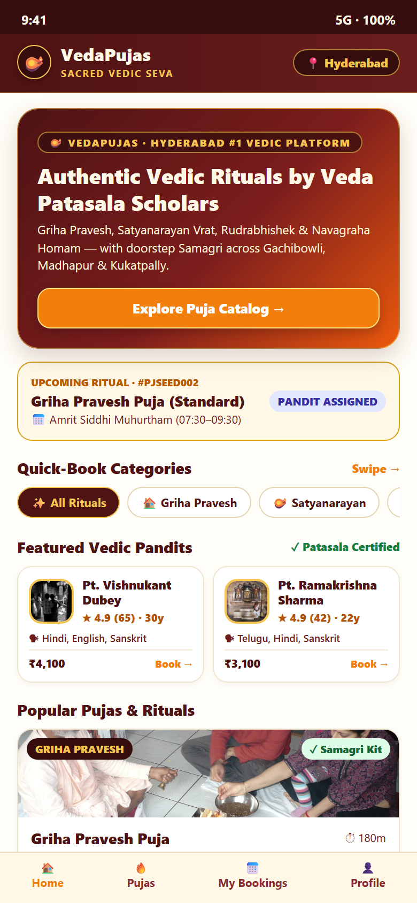
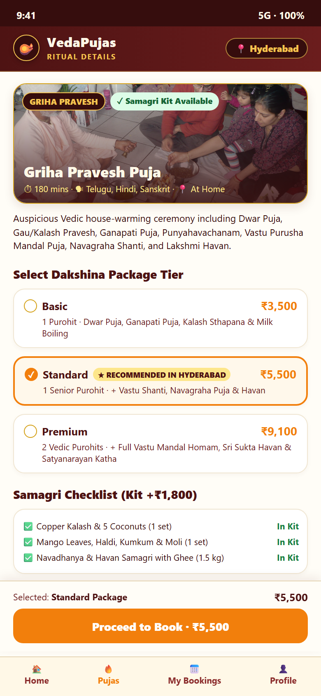
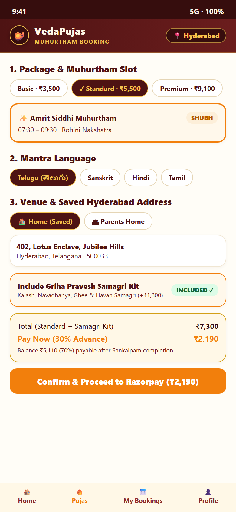
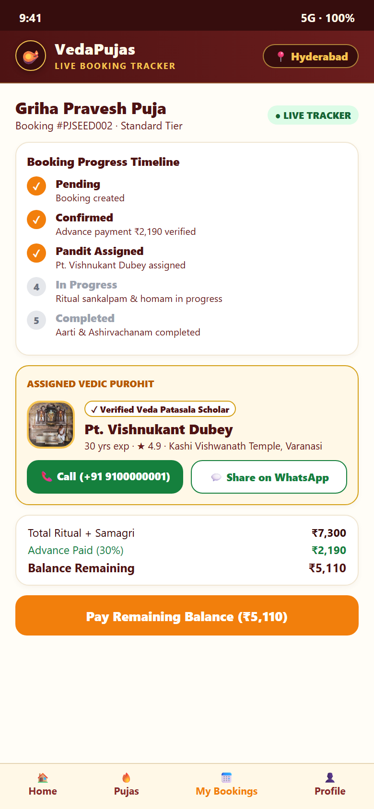
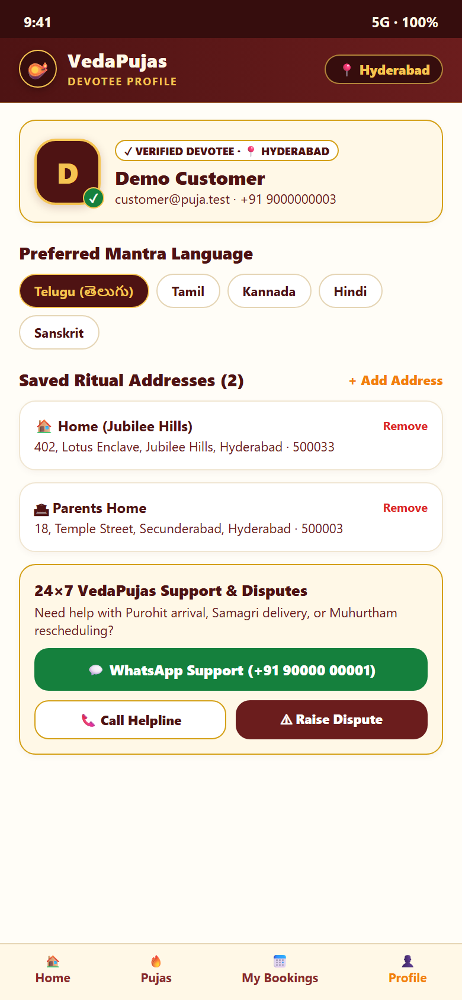

# Puja Platform — Customer Mobile App Screenshots (`user-app/screenshots/`)

Mobile viewport previews (`390×844` @ 2x DPI) captured automatically via [capture-screenshots.js](../../backend/scripts/capture-screenshots.js).

| # | File | Screen | Description |
| :--- | :--- | :--- | :--- |
| 01 | [`01-mobile-home.png`](./01-mobile-home.png) | [`HomeScreen.tsx`](../src/screens/HomeScreen.tsx) | Sacred hero banner, upcoming booking summary card (`#PJSEED002`), quick-book category chips, featured Vedic pandits, and popular pujas list |
| 02 | [`02-mobile-puja-detail.png`](./02-mobile-puja-detail.png) | [`PujaDetailScreen.tsx`](../src/screens/PujaDetailScreen.tsx) | Ritual breakdown, spiritual significance callout, interactive pricing tier selector, and itemized Samagri checklist |
| 03 | [`03-mobile-booking-flow.png`](./03-mobile-booking-flow.png) | [`BookingFlowScreen.tsx`](../src/screens/BookingFlowScreen.tsx) | Package & Auspicious Muhurtham slot selector, mantra language chips, saved address selector, Samagri kit add-on toggle, and 30% advance payment summary |
| 04 | [`04-mobile-booking-timeline.png`](./04-mobile-booking-timeline.png) | [`BookingDetailScreen.tsx`](../src/screens/BookingDetailScreen.tsx) | Live Socket.io 5-step ritual timeline (`Pending` → `Confirmed` → `Pandit Assigned` → `In Progress` → `Completed`), one-tap **Call Pandit** CTA, and balance payment sheet |
| 05 | [`05-mobile-profile.png`](./05-mobile-profile.png) | [`ProfileScreen.tsx`](../src/screens/ProfileScreen.tsx) | Verified Devotee profile card, preferred mantra language selector, saved ritual addresses manager, and 24×7 Emergency Puja Helpline & Dispute support |

---

## Visual Preview Index

| Home (`01-mobile-home.png`) | Puja Detail (`02-mobile-puja-detail.png`) | Booking Flow (`03-mobile-booking-flow.png`) |
| :---: | :---: | :---: |
|  |  |  |

| Booking Timeline (`04-mobile-booking-timeline.png`) | Devotee Profile (`05-mobile-profile.png`) |
| :---: | :---: |
|  |  |

